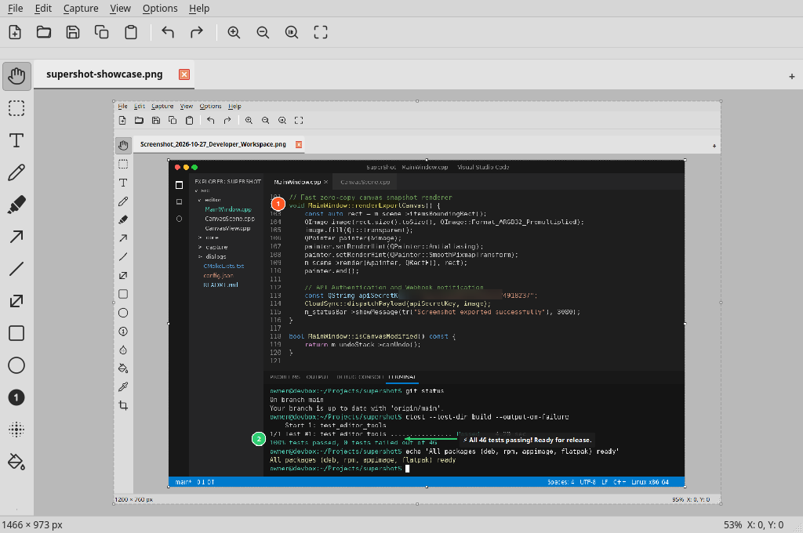

# SuperShot

[](https://github.com/uri-travoski/supershot/releases)
[](https://www.gnu.org/licenses/gpl-3.0)

**SuperShot** is an ultra-lightweight, high-performance Linux screenshot taking and annotation tool with a **ksnip-inspired** user interface and workflows.

It is designed to consume minimal system resources (~7–12 MB private RAM idle in the system tray, well under 60 MB under active multi-tab usage), while providing an authentic Photoshop-style annotation and capture toolset for daily workflows.



---

## Features

- **System Tray Integration**:
  - Runs quietly in the background with minimal memory footprint (~7.8 MB idle).
  - Uses the custom green and white SVG icon.
  - Right-click tray menu includes:
    1. **Open**: Opens an existing image in the annotation editor.
    2. **Editor**: Opens the annotation editor to paste an image or create a blank canvas.
    3. **Capture Fullscreen**: Grabs the entire virtual display.
    4. **Capture Selected Region**: Interactive snipping overlay with 8x magnifier loupe, crosshair, pixel dimensions, and live color readout.
    5. **Colour Picker**: Interactive screen loupe displaying real-time RGB and HEX values; clicking copies `#HEX` to clipboard with a desktop notification.
    6. **Settings**: Configures autostart, save directories, formats, and hotkeys.
    7. **About**: Shows app details and a live RAM footprint meter.
    8. **Quit**: Terminates the application.
  - Closing the editor window minimizes to the system tray.

- **Annotation Editor (ksnip-like UI & Multi-Tab Support)**:
  - Multi-tab editing: open and edit multiple screenshots or images simultaneously.
  - Left-hand vertical toolbar containing Photoshop-style annotation tools:
    - **Pan / Hand Tool**: Smooth click-and-drag viewport panning across large images.
    - **Select Tool**: Select and move vector annotations, **plus area selection** on the screenshot canvas with instant floating action buttons:
      - 📋 **Copy**: Copies the selected area to clipboard.
      - ✂ **Cut**: Copies to clipboard and clears the area on the image.
      - 🗑 **Delete**: Erases the selected area with white fill.
      - ⛶ **Crop**: Crops the canvas to the selected area.
    - **Interactive Canvas Resize Handles**: 8 perimeter handles allowing dragging to expand the canvas from any edge or corner with full Undo/Redo.
    - **Pen**: Smooth freehand calligraphy and drawing.
    - **Highlighter**: Balanced, translucent highlighting brush preserving underlying text and syntax.
    - **Line**: Straight line tool.
    - **Arrow**: Clean directional arrow with arrowhead.
    - **Double Arrow**: Two-way directional arrow.
    - **Rectangle**: Outlined and filled rectangles.
    - **Ellipse**: Outlined and filled circles/ellipses.
    - **Text**: Custom text with editable font, size, and styling.
    - **Number / Stepper Badge**: Auto-incrementing circular badges (`1`, `2`, `3`...) with a one-click counter reset.
    - **Blur / Pixelate**: Redaction tool to obscure sensitive information using mosaic blocks.
    - **Crop**: Dedicated crop tool with live handles.
  - Top Toolbar: New, Open, Save, Save As, Copy to Clipboard, Paste image, Undo, Redo, Zoom In, Zoom Out, 100%, Fit to Window.
  - Properties Bar: Stroke color picker, Fill color picker, Stroke width (1–50px), Stepper reset.
  - Status Bar: Image dimensions, zoom factor, and cursor coordinates.

- **Unified Wayland & X11 Support**:
  - Automatically detects the active desktop session without separate packages.
  - On **Wayland**: Uses native XDG Desktop Portals (`org.freedesktop.portal.Screenshot`, `PickColor`, `GlobalShortcuts`).
  - On **X11**: Uses native X11 overlays (`QScreen::grabWindow`, snipping overlay loupe, `XGrabKey`).
  - Single binary works seamlessly across all Linux environments!

- **Settings, Themes & Autostart**:
  - **Dark / Light Theme**: Configurable under Settings. **Light Theme** gives a sleek, neutral **Grey UI** with high-contrast tool icons and grey canvas background; **Dark Theme** provides a clean dark styling. Changes apply live without restart.
  - **Start with PC**: Automatically creates `~/.config/autostart/supershot.desktop` to launch minimized in the system tray on login.
  - **Save Location**: Configurable default directory (e.g. `~/Pictures/Screenshots`).
  - **Formats**: PNG, JPG, BMP, WebP.
  - **Global Hotkeys**: Configurable global shortcuts for Fullscreen, Region, Color Picker, and Editor.

---

## Installation & Packages

Prebuilt releases are available on the [Releases page](https://github.com/uri-travoski/supershot/releases):

### 1. Debian / Ubuntu / Linux Mint (`.deb`)
```bash
sudo dpkg -i supershot-1.35.0-Linux.deb
# or
sudo apt install ./supershot-1.35.0-Linux.deb
```

### 2. Fedora / RHEL / openSUSE (`.rpm`)
```bash
sudo rpm -i supershot-1.35.0-Linux.rpm
# or on Fedora:
sudo dnf install ./supershot-1.35.0-Linux.rpm
```

### 3. Universal Linux AppImage (`.AppImage`)
```bash
chmod +x SuperShot-1.35.0-x86_64.AppImage
./SuperShot-1.35.0-x86_64.AppImage
```

### 4. Flatpak Bundle (`.flatpak`)
```bash
flatpak install --user supershot-1.35.0.flatpak
flatpak run io.github.uri_travoski.supershot
```

---

## Building from Source

### Dependencies
- C++20 compiler (`g++` or `clang++`)
- CMake (>= 3.16)
- Qt 6 (Core, Gui, Widgets, Svg, Network, Test)
- X11 development headers (`libx11-dev`, `libxtst-dev`)

#### Install Dependencies on Ubuntu/Debian:
```bash
sudo apt update
sudo apt install -y cmake g++ qt6-base-dev qt6-svg-dev libx11-dev libxtst-dev
```

#### Build:
```bash
cmake -B build -DCMAKE_BUILD_TYPE=Release -DCMAKE_INSTALL_PREFIX=/usr
cmake --build build -j$(nproc)
```

#### Run:
```bash
./build/supershot --tray      # Launch in system tray
./build/supershot             # Launch annotation editor
./build/supershot --region    # Trigger region capture
```

---

## License

GNU General Public License v3.0 or later (GPL-3.0-or-later).
